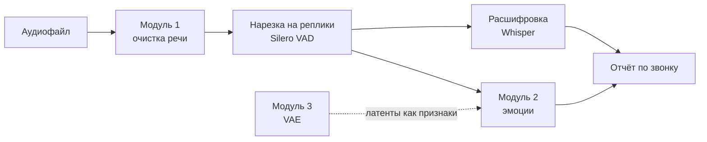

# Анализ звонков: очистка речи, распознавание эмоций и латентное пространство речи

Курсовая работа «Глубокое обучение для анализа и преобразования речевого аудио». Система из трёх нейросетевых модулей и веб-демо:

1. **Отделение голоса от фона** - U-Net на спектрограмме и Conv-TasNet на сигнале, три функции потерь.
2. **Распознавание эмоций в русской речи** - четыре представления аудио (waveform, лог-мел, HuBERT, латенты VAE) и три функции потерь против дисбаланса классов.
3. **VAE на мел-спектрограммах** - генерация и интерполяция коротких слов, озвучка через HiFi-GAN.

Плюс визуализация пространства признаков по эпохам (UMAP + silhouette) и сквозная оценка: насколько очистка снижает WER Whisper и повышает точность эмоций на зашумлённой речи.



## Результаты

Заполняются после обучения командой `python -m callaudio.report` (таблицы появляются в `reports/`).

| Модуль | Лучшая модель | Метрика | Значение |
| --- | --- | --- | --- |
| Очистка речи | - | SI-SDRi, дБ / PESQ / STOI | - |
| Очистка → Whisper | - | WER: зашумлённая → очищенная | - |
| Эмоции (Dusha, 4 класса) | - | macro F1 / UA | - |
| VAE | - | точность линейного классификатора на латентах | - |

## Быстрый старт в Google Colab

Ноутбуки запускаются по порядку; данные и модели сохраняются на Google Drive (`MyDrive/coursework`).

| Ноутбук | Что делает | Colab |
| --- | --- | --- |
| `00_setup_and_data` | скачивает и готовит датасеты, графики данных | [открыть](https://colab.research.google.com/github/tanyalebedeva/call-audio-analysis/blob/main/notebooks/00_setup_and_data.ipynb) |
| `01_separation` | 6 прогонов модуля 1, оценка, WER | [открыть](https://colab.research.google.com/github/tanyalebedeva/call-audio-analysis/blob/main/notebooks/01_separation.ipynb) |
| `02_emotion` | представления и функции потерь, шум, слои HuBERT, UMAP | [открыть](https://colab.research.google.com/github/tanyalebedeva/call-audio-analysis/blob/main/notebooks/02_emotion.ipynb) |
| `03_vae` | VAE, β-VAE, CVAE, интерполяция, вокодеры | [открыть](https://colab.research.google.com/github/tanyalebedeva/call-audio-analysis/blob/main/notebooks/03_vae.ipynb) |
| `04_demo` | веб-демо с публичной ссылкой | [открыть](https://colab.research.google.com/github/tanyalebedeva/call-audio-analysis/blob/main/notebooks/04_demo.ipynb) |

Каждый прогон сохраняет чекпойнт после каждой эпохи и ограничен по времени (`max_minutes`). Если Colab оборвал сессию, запустите ту же команду ещё раз - обучение продолжится с последней эпохи.

## Эксперименты

| Модуль | Конфиги | Что сравнивается |
| --- | --- | --- |
| 1 | `configs/separation/{unet,tasnet}_{l1,sisdr,mrstft}.yaml` | спектрограмма против waveform × L1 по спектру, SI-SDR, multi-resolution STFT |
| 2 | `configs/emotion/{wave_cnn,mel_cnn,hubert_frozen,hubert_finetune,latent_vae}.yaml` | представления аудио; функции потерь через `--set loss.name=weighted_ce\|focal` |
| 3 | `configs/vae/{vae_mse,vae_l1,vae_beta4,cvae,vae_dusha}.yaml` | MSE против L1, β = 1 против 4, условный VAE |

```bash
python -m callaudio.train --config configs/separation/unet_sisdr.yaml
python -m callaudio.train --config configs/emotion/mel_cnn.yaml --set loss.name=focal out_dir=runs/emo_mel_focal
python -m callaudio.evaluate separation --ckpt runs/sep_unet_sisdr/best.pt --wer
python -m callaudio.evaluate emotion --ckpt runs/emo_mel_ce/best.pt --noise-snr 5 --enhancer runs/sep_unet_sisdr/best.pt
python -m callaudio.evaluate vae --ckpt runs/vae_mse/best.pt --pair yes,no
python -m callaudio.viz --run runs/emo_mel_ce
python -m callaudio.report --runs runs --out reports
```

Метрики: SI-SDRi, PESQ, STOI и WER по корзинам SNR (−5…15 дБ) и типу фона; UA, WA, macro F1 и матрица ошибок; ошибка реконструкции, точность линейного классификатора на латентах, silhouette и «судья» - классификатор слов, проверяющий реконструкции и генерации.

## Демо

Вкладки: **анализ звонка** (очистка, спектрограммы до и после, реплики с текстом и эмоцией, доля негатива, отчёт CSV), **латентное пространство** (интерполяция между двумя записанными словами) и **карта эмоций** (UMAP эмбеддингов, реплики загруженного файла появляются на карте).

```bash
ENHANCER_CKPT=runs/sep_unet_sisdr/best.pt EMOTION_CKPT=runs/emo_hubert_ft_ce/best.pt \
VAE_CKPT=runs/vae_mse/best.pt UMAP_PKL=runs/emo_hubert_ft_ce/viz/umap_final.pkl python app/app.py --share
```

Без `EMOTION_CKPT` используется открытая модель [HuBERT, дообученная на Dusha](https://huggingface.co/xbgoose/hubert-large-speech-emotion-recognition-russian-dusha-finetuned).

**Hugging Face Spaces.** Создайте Space с SDK Gradio, положите в него папки `callaudio/`, `app/`, файл `requirements.txt`, файл `packages.txt` со строкой `ffmpeg` и чекпойнты; в настройках Space задайте переменные окружения с путями к чекпойнтам и команду запуска `python app/app.py`.

## Проверка без данных

Все датасеты умеют работать в синтетическом режиме (`data.synthetic=true`): за минуту проверяется весь цикл - обучение, продолжение с чекпойнта, метрики, эмбеддинги.

```bash
pip install -r requirements.txt
python -m pytest
```

## Структура

```
callaudio/
  audio.py        загрузка аудио, смешивание с SNR, телефонный канал, мел-спектрограммы
  data/           датасеты, синтетика, скачивание и подготовка данных (prepare.py)
  models/         U-Net, Conv-TasNet, классификаторы эмоций, VAE
  losses.py       SI-SDR, multi-resolution STFT, focal loss, VAE + KL annealing
  tasks.py        описание трёх задач для общего цикла обучения
  train.py        обучение: AMP, чекпойнты, продолжение, эмбеддинги по эпохам
  evaluate.py     оценка на тесте, примеры аудио, матрицы ошибок
  viz.py          UMAP / t-SNE по эпохам, GIF, silhouette
  vocoder.py      Griffin-Lim и HiFi-GAN
  pipeline.py     конвейер анализа звонка для демо
  report.py       сводные таблицы для записки
configs/          YAML-конфиги всех экспериментов
notebooks/        ноутбуки Colab
app/app.py        веб-демо на Gradio
tests/            тесты на синтетике
```

## Данные

| Датасет | Использование | Лицензия |
| --- | --- | --- |
| [Golos](https://openslr.org/resources/114/about.html) (test) | речь с расшифровками | см. репозиторий Golos |
| [MUSAN](https://openslr.org/17/) (noise, music) | фон | CC BY 4.0 |
| [Dusha](https://huggingface.co/datasets/xbgoose/dusha) | эмоции | см. репозиторий Dusha |
| [Speech Commands v0.02](https://www.huggingface.co/datasets/google/speech_commands) | короткие слова | CC BY 4.0 |

Данные и веса моделей не хранятся в репозитории - только код и скрипты скачивания. Перед публикацией обученных моделей проверьте лицензии Dusha и Golos.

## Стек

PyTorch, torchaudio, Hugging Face Transformers и Datasets, torchmetrics, faster-whisper, Silero VAD, SpeechBrain (HiFi-GAN), umap-learn, scikit-learn, Gradio.
